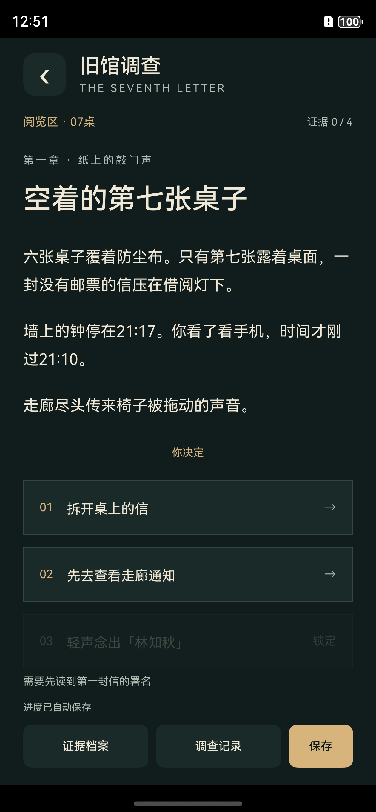
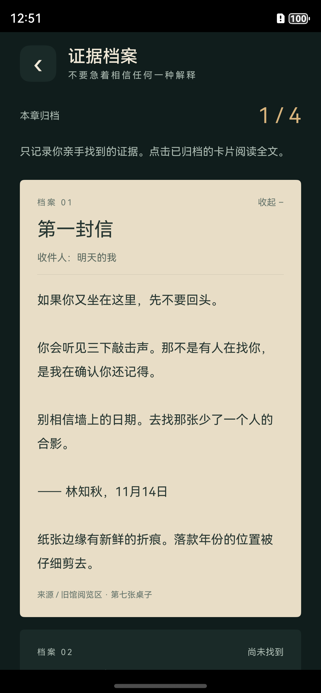
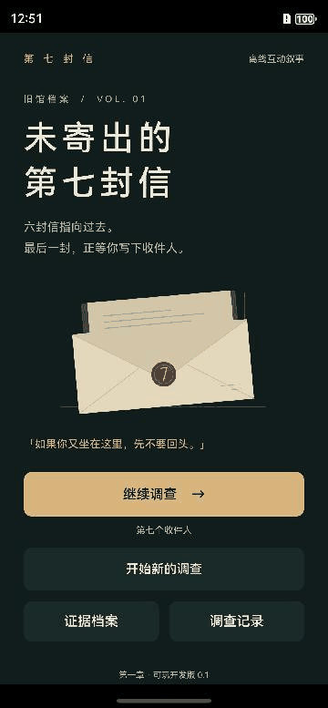
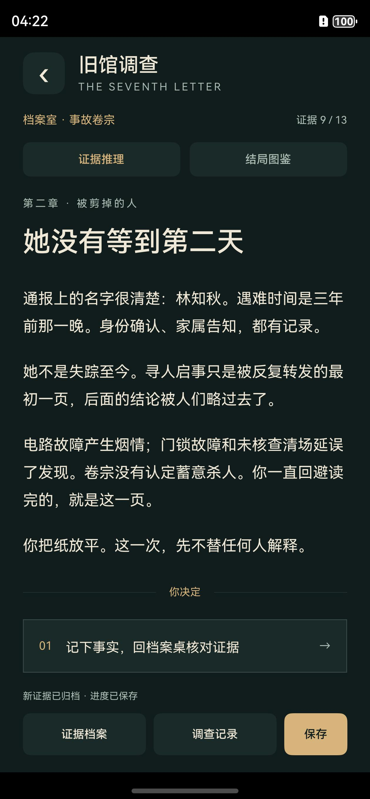
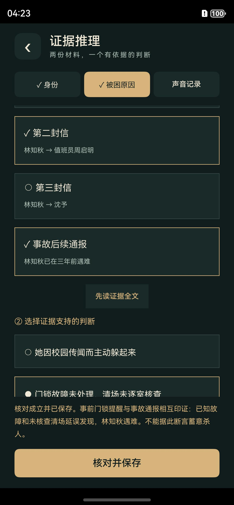
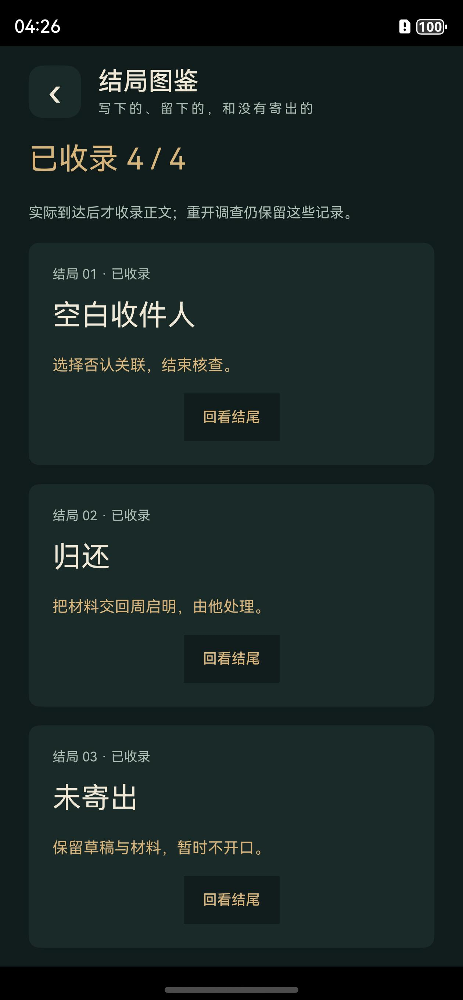

# 未寄出的第七封信 · SeventhLetter

一款使用 ArkTS / ArkUI 开发的鸿蒙校园悬疑互动叙事课程项目。你在旧图书馆发现六封未寄出的信。照片、日期、证词彼此冲突，而第七封信正在等待你写下收件人。

**当前状态：四章故事开发版 0.2。** 已接入完整事件线、六封信、证据推理和四个结局。课程报告、视觉打磨与最终交付验收仍需继续，不把功能版等同于最终作业成品。

## 已有功能

- 主页、调查、证据档案、调查记录、证据推理、结局图鉴六个 ArkUI 原生页面
- 四章共28个节点（含确认与结局），六封信、十三项证据
- 推理需选两份已取得证据和一个判断，错误可重试；三项核对控制后续选项
- 第七封信根据已核对的事实生成，四种最终选择有确认页面
- 四个结局实际到达后收录，可回看、返回抉择前补查；新调查保留结局图鉴
- 离线剧情与确定性规则；可重复搜查，证据不重复计数
- Preferences 自动存档、手动保存；强制关闭应用后继续
- 已收集证据展开阅读、真实选择历史、新调查覆盖确认、0.1存档兼容加载
- 坏档校验与错误提示；Mock 读写失败、版本和边界测试

## 实际界面与操作演示

以下为0.1版第一章的真实模拟器画面，后续故事沿用该视觉：

| 主页 | 探索与线索条件 | 信件档案 |
| --- | --- | --- |
|  |  |  |

第一章历史操作录屏（0.1版，低帧率 GIF，含开局、搜证、关闭后恢复和取消重开，尚未替换为完整新版录屏）：



新版后续章节与玩法截图（包含剧情剧透）：

| 事故材料 | 证据推理 | 结局收录 |
| --- | --- | --- |
|  |  |  |

## 环境

- DevEco Studio 5.0.5 Release（5.0.13.240）
- HarmonyOS 5.0.5 / API 17，Phone，Stage，ArkTS
- 本地使用 DevEco 自带 Node、JBR、Hvigor，无需安装全局 npm 包

## 在老师电脑运行

1. 下载源码或 `git clone` 本仓库，在 DevEco Studio 打开工程根目录。
2. 安装/选择兼容 API 17 的 HarmonyOS SDK，等待 Sync / ohpm 依赖恢复。
3. 在 Device Manager 创建 API 17 的 Phone 模拟器并启动；也可连接兼容鸿蒙设备。
4. 选择 entry / default 与目标设备，按 IDE 提示配置本机签名，点击运行三角。

本机 API 17 模拟器已实测可安装未签名 HAP。也可在完成 IDE 同步后，启动一个模拟器，通过 PowerShell 运行（替换安装目录）：

```powershell
powershell -ExecutionPolicy Bypass -File .\scripts\dev.ps1 -Task Run -DevEcoHome 'D:\huawei\DevEco Studio'
```

GitHub 网页展示代码和演示材料，不直接运行 HarmonyOS 应用。签名证书、机器路径、依赖目录和构建缓存不提交，需在运行者电脑配置。

## 文档

- [需求说明与阶段计划](docs/需求说明.md)
- [上手、运行、修改与复验指南](docs/上手与修改指南.md)
- [四章故事与结局验收记录](docs/第二阶段验收记录.md)
- [31 项 Hvigor 单元测试原始结果](docs/test-results/hvigor-unit-v02.txt)
- [新版模拟器实际验收结果](docs/emulator-story-v02.json)
- [故事设定与明确结局条件（剧透）](docs/故事设定与结局条件.md)
- [第一阶段历史验收记录](docs/开发与验收记录.md)

## 验证

`assembleHap` 构建通过；Hvigor 单元测试31/31通过；同一组宿主Mock测试31/31通过。测试新增精确证据组合、错误判断、完整剧情图可达性、四结局及取消确认、图鉴保留和旧档迁移。

本机 API 17 原生模拟器12/12项验收通过：从开头实际走通四章与四结局，验证错误推理不解锁、取消确认、强制关闭后恢复、图鉴回看和重开保留图鉴。测试结束后已逐字节核对并恢复测试前的旧存档，详见验收JSON。

单元测试使用Mock存储，与原生Preferences的实际进程恢复测试分别记录。尚未验证所有设备或完成最终交付验收；本机模拟器曾有系统渲染冻结，保留在历史问题记录中。

## 工程结构

```text
entry/src/main/ets/
  model/        显式数据模型
  data/         四章节点、信件、线索、推理与结局定义
  engine/       条件判断、状态转换、存档状态校验
  storage/      存储接口、SaveRepository、Preferences 适配
  components/   共用标题栏、视觉样式
  pages/        六个原生页面与导航
entry/src/test/  正常、边界、异常与 Mock 测试
scripts/        构建运行、宿主测试、模拟器操作与录屏
docs/           需求、指南、验收记录、真实截图与录屏
```

## 下一阶段

学生试玩审核剧情与节奏，完善视觉、小屏幕和字体放大体验，检查长时间稳定性，从全新下载的工程复现构建，录制全剧情演示，完成课程报告与答辩材料。

## 开发约定

单人独立课程项目，使用 AI 辅助设计、编码和验证，提交记录保留每阶段真实变更。剧情纯本地运行，不需要模型令牌。源码、测试和文档一并维护。
