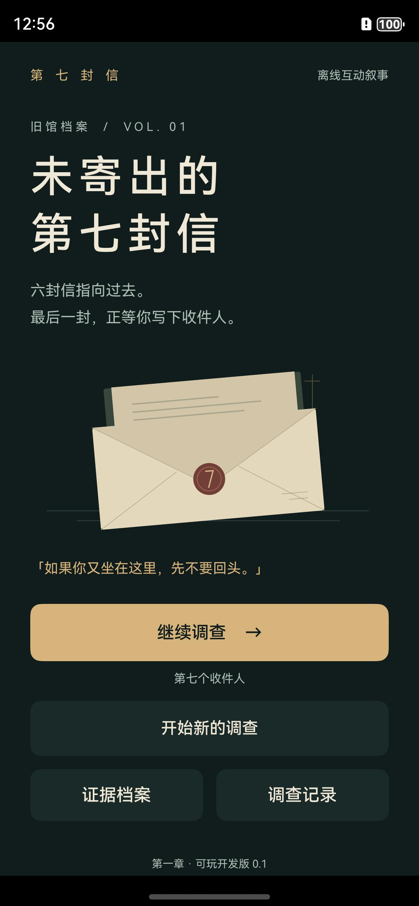

# 未寄出的第七封信 · SeventhLetter

一款使用 ArkTS / ArkUI 开发的鸿蒙校园悬疑互动叙事课程项目。你在旧图书馆发现六封未寄出的信。照片、日期、证词彼此冲突，而第七封信正在等待你写下收件人。

**当前状态：第一章可玩开发版 0.1。** 已在 API 17 Phone 模拟器完成实际运行、探索、搜证和关闭进程后恢复验证。完整六封信、四个最终结局与课程报告仍在后续计划中。

## 已有功能

- 主页、调查、证据档案、调查记录四个 ArkUI 原生页面
- 11 个剧情节点、4 项证据，线索和剧情标记共同决定选项可用性
- 离线剧情与确定性规则；可重复搜查，证据不重复计数
- Preferences 自动存档、手动保存；强制关闭应用后继续
- 已收集证据展开阅读、真实选择历史、新调查覆盖确认
- 坏档校验与错误提示；Mock 读写失败、版本和边界测试

## 实际界面与操作演示

以下来自运行中的 HarmonyOS 模拟器：

| 主页 | 探索与线索条件 | 信件档案 |
| --- | --- | --- |
|  |  |  |

连续采样的真实模拟器操作录屏（低帧率 GIF，含开局、搜证、关闭后恢复、第一章结尾和取消重开）：


## 环境

- DevEco Studio 5.0.5 Release（5.0.13.240）
- HarmonyOS 5.0.5 / API 17，Phone，Stage，ArkTS
- 本地使用 DevEco 自带 Node、JBR、Hvigor，无需安装全局 npm 包

## 在老师电脑运行

1. 下载源码或 `git clone` 本仓库，在 DevEco Studio 打开工程根目录。
2. 安装/选择兼容 API 17 的 HarmonyOS SDK，等待 Sync / ohpm 依赖恢复。
3. 在 Device Manager 创建 API 17 的 Phone 模拟器并启动；也可连接兼容鸿蒙设备。
4. 选择 entry / default 与目标设备，按 IDE 提示配置本机签名，点击运行三角。

本机 API 17 模拟器已实测可安装未签名 HAP。也可在完成 IDE 同步后，启动一个模拟器，通过 PowerShell 运行（替换安装目录）：

```powershell
powershell -ExecutionPolicy Bypass -File .\scripts\dev.ps1 -Task Run -DevEcoHome 'D:\huawei\DevEco Studio'
```

GitHub 网页展示代码和演示材料，不直接运行 HarmonyOS 应用。签名证书、机器路径、依赖目录和构建缓存不提交，需在运行者电脑配置。

## 文档

- [需求说明与阶段计划](docs/需求说明.md)
- [上手、运行、修改与复验指南](docs/上手与修改指南.md)
- [开发与验收记录](docs/开发与验收记录.md)
- [19 项 Hvigor 单元测试原始结果](docs/test-results/hvigor-unit.txt)
- [模拟器实际验收结果](docs/emulator-smoke.json)

## 验证

`assembleHap` 构建通过；Hvigor 单元测试 19/19 通过；同一组宿主 Mock 测试 19/19 通过。原生模拟器验证线索锁定/解锁、去重、档案展开、强制停止后恢复、第一章流程、手动保存、记录和取消重开。

单元测试使用 Mock 存储，与原生 Preferences 的实际进程恢复测试分别记录。尚未验证所有设备或完成全剧情验收。

## 工程结构

```text
entry/src/main/ets/
  model/        显式数据模型
  data/         第一章节点、选项、信件与线索
  engine/       条件判断、状态转换、存档状态校验
  storage/      存储接口、SaveRepository、Preferences 适配
  components/   共用标题栏、视觉样式
  pages/        四个原生页面与导航
entry/src/test/  正常、边界、异常与 Mock 测试
scripts/        构建运行、宿主测试、模拟器操作与录屏
docs/           需求、指南、验收记录、真实截图与录屏
```

## 下一阶段

确定三年前事件的完整时间线，增加档案室、另外五封信、其余角色、可操作的证据组合与四个结局，再做视觉改进和答辩材料。第一章末尾是开发阶段终点，尚不是完整作品的最终结局。

## 开发约定

单人独立课程项目，使用 AI 辅助设计、编码和验证，提交记录保留每阶段真实变更。剧情纯本地运行，不需要模型令牌。源码、测试和文档一并维护。
